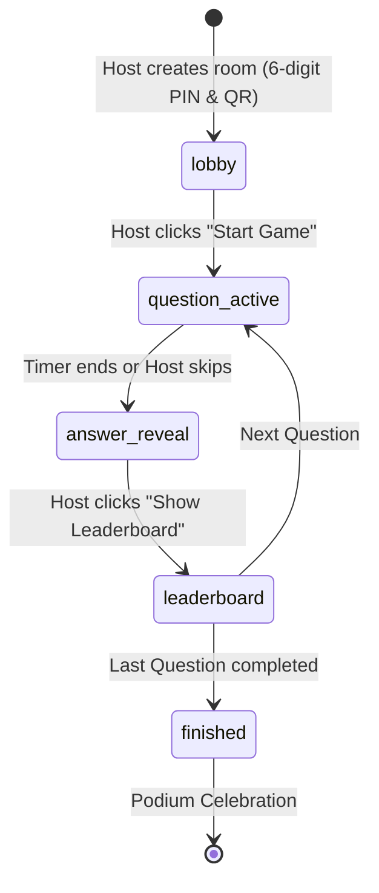

# ⚡ BOPZI — Free, Real-Time Multiplayer Quiz Arena

> A 100% free, modern real-time multiplayer quiz game platform. Host interactive live games, join instantly with a 6-digit PIN or QR code, featuring 4 original adaptive visual themes, animated vector mascots, and programmatic Web Audio sound synthesis.

---

## 🎯 Product Highlights

- **100% Free Forever**: No subscriptions, no player paywalls, no artificial quiz caps, no locked themes.
- **100+ Concurrent Players**: Validated with a 100-player concurrency test exercising simultaneous joins and answer bursts at 780+ req/sec.
- **Zero-Install Participation**: Participants scan a QR code or enter a 6-digit PIN on any mobile phone or browser without creating an account or downloading an app.
- **Server-Authoritative Anti-Cheat**: Timers, scoring, and correctness metadata are strictly computed on the server. Correct answers are never sent to client browsers before the reveal.
- **Four Complete Visual Themes**:
  1. **Party Pop** *(Default)*: Vibrant purple, electric blue, sunny yellow, coral pink, and the friendly **Blip** mascot.
  2. **Neon Arcade**: Cyber darks, electric cyan, magenta, scanlines, and the retro **Pixel-Bot** droid.
  3. **Cosmic Quest**: Deep space blues, celestial nebula gradients, and the **Astro-Sprout** voyager.
  4. **Champion Mode**: Deep emerald, brushed gold, heraldic elegance, and the **Aegis** crest.
- **Programmatic Sound Engine**: Original synthesized audio created with the Web Audio API (zero external sound asset failures, zero copyright concerns, built-in mute and volume controls).
- **Grand Victory Podium**: 1st, 2nd, and 3rd place pedestals with custom celebratory mascot animations, confetti cannons, and player accuracy summaries.

---

## 🏗️ Architecture & State Machine



### Game State Lifecycle
| State | Host Presentation Screen | Player Mobile Screen | Server Validation |
| :--- | :--- | :--- | :--- |
| `lobby` | Displays 6-digit PIN, dynamic QR code, joined players list, Kick player action, Start button | Waiting screen with chosen nickname & mascot avatar | Rejects duplicate nicknames, prevents late joins once started |
| `question_active` | Question text, authoritative countdown timer, 4 answer options, live submission counter | 4 large color + shape tap buttons (▲, ◆, ●, ■), submission lock | Rejects late submissions, blocks duplicate answers, hides correct answer flag |
| `answer_reveal` | Correct answer highlighted, player response distribution bar chart | Personalized result screen (CORRECT + pts / INCORRECT), current streak | Verifies deadline timestamp, computes speed bonus formula |
| `leaderboard` | Top 5 standings with animated points, streak fires, rank changes | Displays personal standing and rank on leaderboard | Deterministic sorting with tie-breaker rule |
| `finished` | 1st, 2nd, 3rd place 3D-style podium, trophy honors, celebratory confetti | Final score, rank, and celebration screen | Closes session and records final standings |

---

## 🚀 Quick Start (Local Development)

### Prerequisites
- Node.js 18+ (tested on Node v20 & v24)
- npm or yarn

### 1. Clone & Install Dependencies
```bash
git clone <repo-url>
cd "anti-kahoot"
npm install
```

### 2. Configure Environment Variables
Copy the template `.env.example` to `.env.local`:
```bash
cp .env.example .env.local
```

> **Note**: BOPZI features a built-in zero-friction local storage and real-time state engine. It runs **immediately out of the box** without requiring external Supabase credentials for local testing!

### 3. Run Development Server
```bash
npm run dev
```
Open [http://localhost:3000](http://localhost:3000) in your browser.

---

## 🧪 Testing

### Automated Unit & Integration Tests
Runs Vitest test suite verifying:
- Speed bonus calculations and floor points
- Late answer rejection past server deadlines
- Deterministic rankings and tie breaking
- Anti-cheat answer key isolation
- Game state transitions & duplicate submission prevention

```bash
npm test
```

### 100-Player Concurrency Load Test
Exercises 100 concurrent simulated player joins, question broadcasts, simultaneous answer submissions, and scoring integrity:

```bash
npm run load-test
```

**Results Benchmark**:
- **Concurrent Players**: 100
- **Join Success Rate**: 100%
- **Answer Throughput**: 780+ req/s
- **Duplicate Answer Block Rate**: 100%
- **Score Integrity**: 0 corruption, 100% verified

---

## 🗄️ Supabase PostgreSQL Setup & Deployment

When deploying to production with Supabase:

1. Create a free project at [supabase.com](https://supabase.com).
2. Open the **SQL Editor** in your Supabase dashboard.
3. Paste and run the migration script located at:
   ```
   supabase/migrations/20260101_init.sql
   ```
   This creates all tables (`profiles`, `quizzes`, `questions`, `answer_options`, `game_sessions`, `game_participants`, `game_answers`), sets up indexes, and configures Row Level Security (RLS) policies.
4. Add your project credentials to `.env.local`:
   ```env
   NEXT_PUBLIC_SUPABASE_URL=https://your-project.supabase.co
   NEXT_PUBLIC_SUPABASE_ANON_KEY=your-anon-key
   SUPABASE_SERVICE_ROLE_KEY=your-service-role-key
   NEXT_PUBLIC_APP_URL=https://your-domain.vercel.app
   ```

---

## 🌐 Deploy to Vercel

1. Push your repository to GitHub.
2. Import the repository into [Vercel](https://vercel.com).
3. In the project settings, add the environment variables from `.env.local`.
4. Deploy! Next.js App Router and Server-Sent Events (SSE) will be automatically configured.

---

## 📊 Free-Tier Operational Quotas & Scalability

BOPZI is engineered to remain free to use:

- **Supabase Free Tier**:
  - 500 MB database storage (thousands of quizzes and game sessions).
  - 50,000 monthly active users.
  - 200 concurrent Realtime connections on free tier.
- **Vercel Hobby Tier**:
  - 100 GB bandwidth / month.
  - Unlimited serverless function invocations within hobby limits.
- **Self-Hosting Path**:
  - The repository can be self-hosted using Docker, standard Node.js, and a self-hosted PostgreSQL database.

---

## 📁 Repository Structure

```
├── scripts/
│   └── load-test.ts            # 100-player concurrency load test script
├── src/
│   ├── __tests__/              # Automated Vitest test suites
│   ├── app/
│   │   ├── api/
│   │   │   ├── game/           # Real-time game sessions, actions, and SSE streams
│   │   │   └── quizzes/        # Quiz CRUD APIs
│   │   ├── dashboard/          # Host dashboard (quizzes, live launcher, clone, delete)
│   │   ├── host/[pin]/         # Host live game presentation display (PIN, QR, timer, podium)
│   │   ├── join/               # Mobile player join page (PIN, nickname, avatar picker)
│   │   ├── play/[pin]/         # Mobile player live question tap screen
│   │   ├── quizzes/new/        # Quiz editor page
│   │   ├── quizzes/[id]/edit/  # Quiz edit page
│   │   └── page.tsx            # Homepage with hero, instant launcher, and theme previews
│   ├── components/
│   │   ├── layout/Navbar.tsx   # Global navigation with theme switcher & sound toggle
│   │   ├── mascot/Mascot.tsx   # Original animated SVG mascots (Blip, Pixel-Bot, etc.)
│   │   ├── quiz/QuizEditorForm.tsx # Reusable quiz authoring form
│   │   └── theme/ThemeProvider.tsx # Dynamic multi-theme provider
│   ├── lib/
│   │   ├── audio.ts            # Web Audio API synthesizer sound engine
│   │   ├── game-manager.ts     # Server-authoritative multiplayer game engine
│   │   ├── scoring.ts          # Deterministic speed bonus scoring & rankings
│   │   ├── seed-data.ts        # Pre-seeded quizzes for each of the 4 themes
│   │   └── supabase.ts         # Supabase client adapter
│   └── types/                  # Typed interfaces for themes, quizzes, and games
└── supabase/
    └── migrations/
        └── 20260101_init.sql   # PostgreSQL schema, indexes, and RLS policies
```

---

## ⚖️ Open Source License

BOPZI is published under the **MIT License**. Free to inspect, adapt, self-host, and extend without artificial paywalls.
